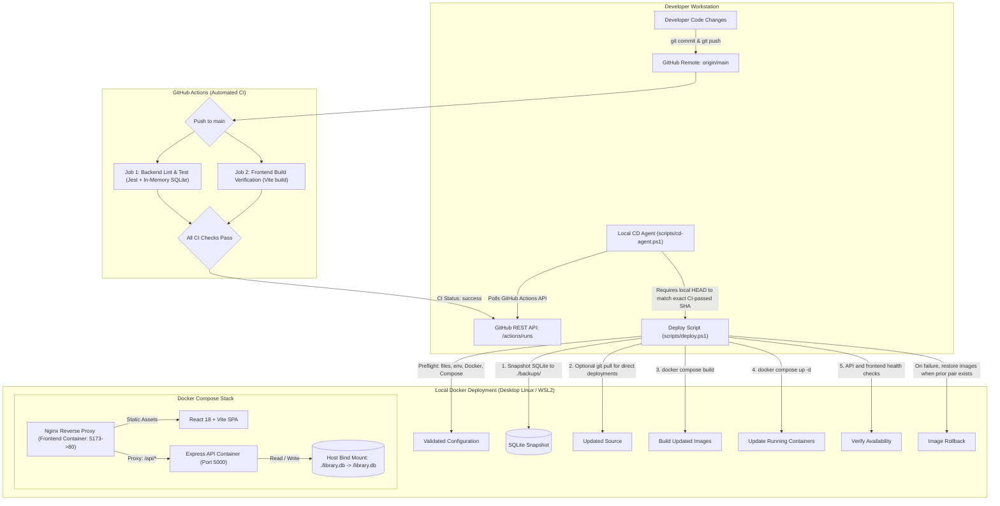

# Containerized Library Management System with Automated CI/CD

A modern, responsive, full-stack **Library Management System (LMS)** built with React, Vite, Tailwind CSS, Node.js/Express, and SQLite, fully containerized with Docker and automated with GitHub Actions CI and automated local Continuous Deployment (CD).

> [!NOTE]
> This application is deployed and accessible locally at `http://localhost:5173`. It does not rely on any public cloud infrastructure or paid hosting services.

---

## 🏗️ System & CI/CD Architecture



---

## 🛠️ Technology Stack

- **Frontend:** React 18, Vite, Tailwind CSS, Lucide React, Recharts, Axios, React Router v6
- **Backend:** Node.js 22, Express.js, JSON Web Tokens (JWT), bcrypt, express-validator, SQLite3
- **Database:** SQLite (`library.db`) with host bind-mount persistence
- **Containerization & Reverse Proxy:** Docker, Docker Compose, Nginx Alpine (Reverse Proxy)
- **Automated CI (Cloud):** GitHub Actions (Parallel backend testing with in-memory SQLite and frontend production build)
- **Automated CD (Local):** Local CD Polling Agent (`scripts/cd-agent.ps1`) and Deployment Engine (`scripts/deploy.ps1`)

---

## 📋 Prerequisites

- **Local Execution:**
  - Node.js (v18+ or v20+)
  - npm (v9+)
- **Containerized Execution:**
  - Docker Desktop (v20+ / Docker 29+) running Linux containers
  - Docker Compose (v2.20+ / Compose v5+)
- **Version Control & CI:**
  - Git
  - GitHub repository (`https://github.com/HARSHITA-JETHANI/containerized-library-management`)
  - PowerShell 5.1+ or PowerShell 7+

---

## 🚀 Automated Local Continuous Deployment (CD)

### How It Works

1. You push new commits to the `main` branch on GitHub.
2. GitHub Actions runs the CI workflow (`.github/workflows/ci.yml`), executing backend tests and verifying the frontend build.
3. The local Continuous Deployment Agent (`scripts/cd-agent.ps1`) checks GitHub Actions for a completed successful push workflow matching the exact full SHA on `main`. It deploys only when local `HEAD` matches that SHA, and invokes the deploy script with `-SkipPull` to prevent deploying a newer, unverified remote commit.
4. The deploy script validates required files, `.env`, Docker, Compose, and Compose configuration before creating a database snapshot or changing deployment state. A direct run without `-SkipPull` also requires a clean `main` worktree and pulls `origin/main` after the snapshot.
5. It preserves available prior Compose images, builds and updates containers, and checks `/api/health` and frontend HTML. A failed build stops the deployment. An update or health failure attempts image rollback when a complete prior backend/frontend image pair exists; it does not restore `library.db`.
6. The CD agent updates `.last_deployed_sha` only after deployment succeeds. It stores a failed SHA in `.last_failed_sha` to suppress repeat attempts for that commit.

### Non-Destructive Deployment Preflight

Run `-DryRun` to validate required files, `.env`, Docker daemon availability, Compose availability, and Compose configuration. The script exits before creating backups, pulling code, building images, or changing containers:

```powershell
powershell -ExecutionPolicy Bypass -File "scripts/deploy.ps1" -DryRun
```

### Starting the Local CD Agent

Open a dedicated PowerShell terminal and run:

```powershell
# Set location to the project root
Set-Location "E:\Harshi\7th SEM\CLOUD AUTOMATION\LibraryManagement"

# Launch the CD polling agent (checks every 30 seconds by default)
powershell -ExecutionPolicy Bypass -File "scripts/cd-agent.ps1"
```

To run a single verification check manually:
```powershell
powershell -ExecutionPolicy Bypass -File "scripts/cd-agent.ps1" -RunOnce
```

---

## 🛡️ Database Protection & Rollback Procedure

### Zero Data Loss Guarantees
- The SQLite database file `library.db` is located on the host machine and bind-mounted to `/library.db` inside the backend container.
- Before **every deployment**, `scripts/deploy.ps1` automatically saves a timestamped snapshot into the `backups/` directory (e.g., `backups/library_backup_20261018_202758.db`).
- Deployment and image-only rollback do not copy over or restore `library.db`; the running application continues to write data to the mounted database.

### Safe Rollback Procedure
The default rollback restores application images only and preserves the current database:

```powershell
# Rollback application images only; library.db is untouched
powershell -ExecutionPolicy Bypass -File "scripts/rollback.ps1"
```

To restore database data, explicitly use `-RestoreDatabase`:

```powershell
# Restore the latest snapshot
powershell -ExecutionPolicy Bypass -File "scripts/rollback.ps1" -RestoreDatabase

# Or restore a specific snapshot
powershell -ExecutionPolicy Bypass -File "scripts/rollback.ps1" -RestoreDatabase -BackupFile "backups/library_backup_YYYYMMDD_HHMMSS.db"
```

---

## 🐳 Running with Docker Compose Manually

### 1. Environment Configuration

Create a `.env` file in the project root by copying `.env.example`:

```powershell
Copy-Item .env.example .env
```

Ensure `JWT_SECRET` is set in `.env`:
```env
JWT_SECRET=your_super_secret_jwt_key_here
PORT=5000
NODE_ENV=production
```

### 2. Build and Launch Containers

```powershell
# Build and start all services in detached mode
docker compose up -d --build
```

### 3. Verify Container Status

```powershell
docker compose ps
```

Both `library-backend-compose` and `library-frontend-compose` should display status `Up`.

### 4. Access the Application

- **Frontend Web UI & API Gateway:** [http://localhost:5173](http://localhost:5173)
- **API Health Check (proxied via Nginx):** [http://localhost:5173/api/health](http://localhost:5173/api/health)

### 5. Stop Containers

```powershell
# Stop containers without removing persistent data
docker compose down

# View logs if needed
docker compose logs -f
```

---

## 💻 Running Locally (Without Docker)

### 1. Backend Setup

```powershell
Set-Location "backend"
npm install
npm test
npm start
```
*Backend server will listen at: `http://localhost:5000`.*

### 2. Frontend Setup

```powershell
Set-Location "frontend"
npm install
npm run dev
```
*Frontend dev server will run at: `http://localhost:5173`.*

---

## 🔑 Default Demo Credentials

| Role | Username | Password | Access Level |
| :--- | :--- | :--- | :--- |
| **Administrator** | `admin` | `admin123` | Full access to all modules, settings, reports, and staff management |

---

## 📦 Implemented Modules & Features

1. **Authentication & Session:** JWT-based authentication with protected route guards and automated header injection.
2. **Dashboard (`/dashboard`):** Real-time statistics cards: Total Books, Available Copies, Issued Books, Active Members, Overdue Loans, Pending Reservations, Outstanding Fines.
3. **Books & Catalog (`/books`):** Catalog management, multi-copy inventory tracking, search by title, ISBN, or author.
4. **Categories (`/categories`):** Book genre classifications with safe deletion guards.
5. **Authors (`/authors`):** Author catalog with search, create, edit, and deletion protection.
6. **Members (`/members`):** Member registration, profile details, borrowing history, and deactivation.
7. **Circulation & Loans (`/loans`):** Book checkout, automated due-date calculation, 1-click returns with overdue fines, and loan renewals.
8. **Reservations (`/reservations`):** Queue-based book waitlist with position tracking.
9. **Fines & Payments (`/fines`):** Overdue fine ledger and payment recording.
10. **System Settings (`/settings`):** Configurable loan duration, renewal limits, and daily fine rates.
11. **Reports & Analytics (`/reports`):** Recharts charts (Category Bar Chart, Circulation Status Pie Chart) and popular books rankings.
12. **Staff User Management (`/users`):** Admin panel for managing staff user accounts and permissions.

---

## 🔧 Troubleshooting & Diagnostic Commands

### Inspecting Running Containers and Logs
```powershell
# View running container status
docker compose ps

# View real-time logs from both services
docker compose logs -f

# View backend logs only
docker compose logs backend --tail=50

# View frontend / Nginx logs only
docker compose logs frontend --tail=50
```

### Inspecting Local CD Deployment Status
```powershell
# Check the last deployed commit SHA
Get-Content .last_deployed_sha

# Run a single CD check with detailed logging
powershell -ExecutionPolicy Bypass -File "scripts/cd-agent.ps1" -RunOnce
```

### Port 5173 or 5000 Already in Use
```powershell
docker compose down
docker ps
```
