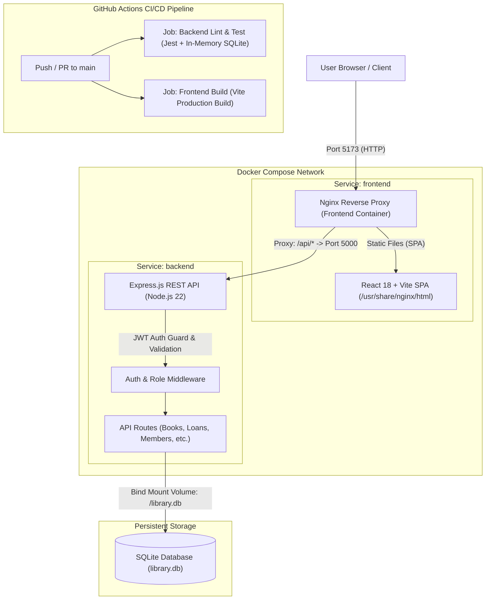

# Containerized Library Management System with Automated CI/CD

A modern, responsive, full-stack **Library Management System (LMS)** built with React, Vite, Tailwind CSS, Node.js/Express, and SQLite, fully containerized with Docker and automated with GitHub Actions CI/CD.

---

## 🏗️ System Architecture



---

## 🛠️ Technology Stack

- **Frontend:** React 18, Vite, Tailwind CSS, Lucide React, Recharts, Axios, React Router v6
- **Backend:** Node.js 22, Express.js, JSON Web Tokens (JWT), bcrypt, express-validator, SQLite3
- **Database:** SQLite (`library.db`) with persistent volume binding
- **Containerization & Reverse Proxy:** Docker, Docker Compose, Nginx Alpine (Reverse Proxy)
- **Automated CI/CD:** GitHub Actions (Backend unit/integration testing with Jest & Supertest, Frontend build verification)

---

## 📋 Prerequisites

- **Local Execution:**
  - Node.js (v18+ or v20+)
  - npm (v9+)
- **Containerized Execution:**
  - Docker Desktop (v20+ / Docker 29+)
  - Docker Compose (v2.20+ / Compose v5+)
- **Version Control & CI:**
  - Git
  - GitHub repository access

---

## 🐳 Running with Docker Compose (Recommended)

### 1. Environment Configuration

Create a `.env` file in the project root by copying `.env.example`:

```powershell
Copy-Item .env.example .env
```

Ensure `JWT_SECRET` is set in `.env` (a strong secret is required):
```env
JWT_SECRET=your_super_secret_jwt_key_here
PORT=5000
NODE_ENV=production
```

### 2. Build and Launch Containers

Run the following command in PowerShell from the project root:

```powershell
# Build and start all services in detached mode
docker compose up -d --build
```

### 3. Verify Container Status

```powershell
docker compose ps
```

Both `library-backend-compose` and `library-frontend-compose` should display status `Up`.

### 4. Access the Application

- **Frontend Web UI & API Gateway:** [http://localhost:5173](http://localhost:5173)
- **API Health Check (proxied via Nginx):** [http://localhost:5173/api/health](http://localhost:5173/api/health)

### 5. Stop Containers

```powershell
# Stop containers without removing persistent data
docker compose down

# View logs if needed
docker compose logs -f
```

> [!NOTE]
> Database data is persisted using a bind mount to `library.db` in the project root. Rebuilding or restarting containers preserves all books, members, loans, and settings.

---

## 💻 Running Locally (Without Docker)

### 1. Backend Setup

Open a PowerShell terminal in the project root:

```powershell
# Navigate to backend
Set-Location "backend"

# Install backend dependencies
npm install

# (Optional) Initialize / seed the database
npm run init-db

# Run automated tests
npm test

# Start backend server on port 5000
npm start
```

*Backend server will listen at: `http://localhost:5000`.*

### 2. Frontend Setup

Open a second PowerShell terminal in the project root:

```powershell
# Navigate to frontend
Set-Location "frontend"

# Install frontend dependencies
npm install

# Start Vite dev server
npm run dev

# Or build for production
npm run build
```

*Frontend dev server will run at: `http://localhost:5173`.*

---

## 🔄 Automated CI/CD Pipeline

The project includes an automated GitHub Actions workflow defined at [`.github/workflows/ci.yml`](file:///.github/workflows/ci.yml):

- **Triggers:** Any `push` or `pull_request` targeting the `main` branch.
- **Job 1: `backend-test` (Ubuntu Latest, Node.js 20):**
  - Installs backend dependencies using clean lockfile (`npm ci`).
  - Runs Jest and Supertest integration tests against in-memory SQLite.
  - Verifies health check, JWT authentication, and module APIs.
- **Job 2: `frontend-build` (Ubuntu Latest, Node.js 20):**
  - Installs frontend dependencies (`npm ci`).
  - Executes production bundle compilation (`npm run build`) via Vite.

---

## 🔑 Default Credentials

| Role | Username | Password | Access Level |
| :--- | :--- | :--- | :--- |
| **Administrator** | `admin` | `admin123` | Full access to all modules, settings, reports, and staff management |

---

## 📦 Implemented Modules & Features

1. **Authentication & Session:**
   - JWT-based authentication with protected route guards and automated header injection.
   - User profile badge and 1-click logout in the top bar.

2. **Dashboard (`/dashboard`):**
   - Real-time statistics cards: Total Books, Available Copies, Issued Books, Active Members, Overdue Loans, Pending Reservations, and Outstanding Fines.

3. **Books & Catalog (`/books`):**
   - Catalog management: Add, edit, and delete books.
   - Multi-copy inventory tracking with auto-generated physical copy records.
   - Filter and search by title, ISBN, or author.

4. **Categories (`/categories`):**
   - Manage book genres and classifications.
   - Safe deletion protection preventing deletion when books are linked.

5. **Authors (`/authors`):**
   - Author catalog with search, create, edit, and linked-book deletion guards.

6. **Members (`/members`):**
   - Register library members with student/staff ID, email, phone, department, and course.
   - Member profile view (`/members/:id/details`) displaying complete borrowing history and active loans.
   - Member search and safe deactivation.

7. **Circulation & Loans (`/loans`):**
   - Issue book copy to active member with automatic due-date calculation based on policy.
   - Active, Overdue, and All Loans filter tabs.
   - 1-click Book Return with automated overdue fine calculation.
   - Loan Renewal with limit enforcement.

8. **Reservations (`/reservations`):**
   - Book waitlist queue with duplicate request prevention.
   - Real-time queue priority position (e.g., `#1 in line`).
   - Fulfill and cancel reservation workflows.

9. **Fines & Payments (`/fines`):**
   - Track overdue charges, collected revenue, and outstanding balances.
   - Partial and full payment recording modal.
   - Overpayment validation preventing recording payments exceeding outstanding balance.

10. **System Settings (`/settings`):**
    - Configurable library name, loan duration days, max books per member limit, renewal limit, overdue fine rate per day, and reservation pickup window.

11. **Reports & Analytics (`/reports`):**
    - Visual Recharts: Books/Copies by Category Bar Chart, Circulation Status Pie Chart.
    - Popular books ranking table (most borrowed titles).
    - Financial collections summary.

12. **Staff User Management (`/users`):**
    - Admin panel to create staff accounts with role-based access (`ADMIN`, `LIBRARIAN`, `ASSISTANT`).
    - Enable/disable user accounts with self-deactivation protection.

---

## 🔧 Troubleshooting

### Port 5173 or 5000 already in use
If another process or previous container is holding port 5173 or 5000:
```powershell
# Check running containers
docker ps

# Stop existing compose stack
docker compose down
```

### Missing `.env` file on Docker Compose startup
If Docker Compose warns about missing `JWT_SECRET`:
```powershell
Copy-Item .env.example .env
# Edit .env and supply a secure JWT_SECRET
```

### Database Persistence Verification
The SQLite database file `library.db` is bind-mounted directly into `/library.db` in the backend container. All book additions, member updates, and loans made through the UI or API persist directly on the host machine across container restarts.
